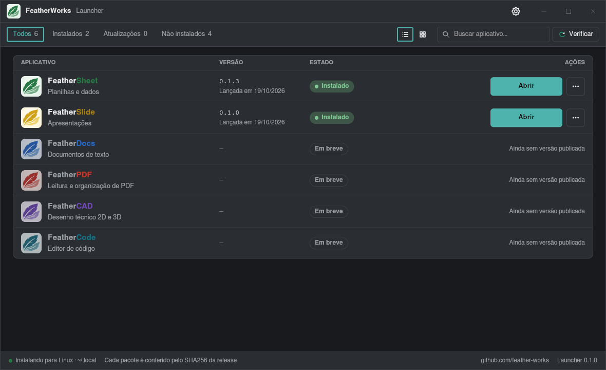

<p align="center">
  
</p>

<h1 align="center">FeatherWorks Launcher</h1>

<p align="center">
  Instala, atualiza e abre os aplicativos da suíte FeatherWorks.
</p>

<p align="center">
  
</p>

## Baixar

| Sistema | Arquivo |
|---|---|
| Linux (Debian, Ubuntu, Mint…) | [featherlauncher-linux-amd64.deb](https://github.com/feather-works/featherlauncher/releases/latest/download/featherlauncher-linux-amd64.deb) |
| Linux (qualquer distribuição) | [featherlauncher-linux-x86_64.tar.gz](https://github.com/feather-works/featherlauncher/releases/latest/download/featherlauncher-linux-x86_64.tar.gz): descompacte e rode `./instalar.sh` |
| Windows 10/11 | [featherlauncher-windows-x64.exe](https://github.com/feather-works/featherlauncher/releases/latest/download/featherlauncher-windows-x64.exe): portátil, é só abrir |

## O que ele faz

- Lista os aplicativos da suíte com a versão instalada e a última publicada no GitHub.
- Instala e atualiza na pasta do usuário, sem administrador (`~/.local` no Linux, `%LOCALAPPDATA%\Programs` no Windows).
- Confere cada pacote pelo `SHA256SUMS` da release antes de instalar.
- Pausa e continua downloads; "Atualizar tudo" de uma vez.
- Consulta o GitHub com cache (ETag) e, se a cota da API acabar, pelo feed de releases.
- Sem conta, sem login, sem telemetria.

## Compilar

```bash
cargo run --release
pacote/gerar.sh          # pacotes em pacote/saida/
```

Licença: GPL-3.0.
