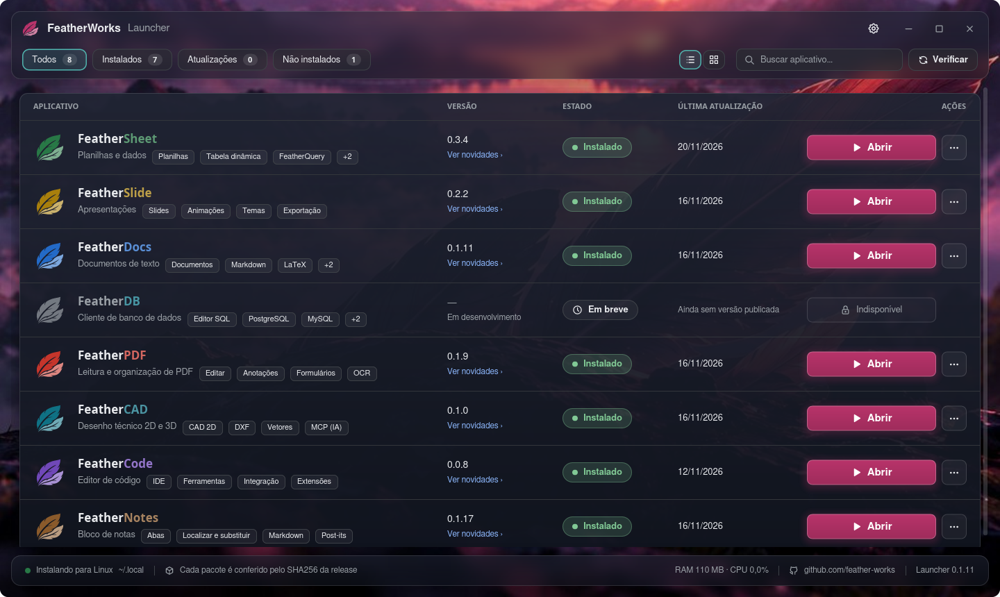

<p align="center">
  
</p>

<h1 align="center">FeatherWorks Launcher</h1>

<p align="center"><a href="https://discord.gg/b4Epb4eSSH"></a></p>

<p align="center">
  Installs, updates and opens the apps of the FeatherWorks suite.
</p>

<p align="center">
  
</p>

## Download

| System | File |
|---|---|
| Linux (Debian, Ubuntu, Mint…) | [featherlauncher-linux-amd64.deb](https://github.com/feather-works/featherlauncher/releases/latest/download/featherlauncher-linux-amd64.deb) |
| Linux (any distribution) | [featherlauncher-linux-x86_64.tar.gz](https://github.com/feather-works/featherlauncher/releases/latest/download/featherlauncher-linux-x86_64.tar.gz): extract it and run `./instalar.sh` |
| Windows 10/11 | [featherlauncher-windows-x64-instalador.exe](https://github.com/feather-works/featherlauncher/releases/latest/download/featherlauncher-windows-x64-instalador.exe): installs to `C:\Program Files\FeatherWorks\Launcher` (asks for administrator once). Portable: [featherlauncher-windows-x64.exe](https://github.com/feather-works/featherlauncher/releases/latest/download/featherlauncher-windows-x64.exe), just open it |

## What it does

- Lists the suite apps with the installed version and the latest one published on GitHub.
- Installs and updates the apps: on Windows in `C:\Program Files\FeatherWorks\<App>` (Windows asks for administrator on each install); on Linux in the user folder (`~/.local`), without administrator.
- On Linux, it uses the copy that is already installed (`.deb`, Snap or Flatpak) instead of installing another one: it updates and opens that copy, shows where it came from and warns when an app is installed more than once.
- Checks every package against the release `SHA256SUMS` before installing.
- Also opens on old graphics cards without usable Vulkan/OpenGL (Intel HD 4000): the window is then drawn by the CPU.
- Pauses and resumes downloads; "Atualizar tudo" (update all) in one go.
- Queries GitHub with a cache (ETag) and, if the API quota runs out, through the releases feed.
- No account, no login, no telemetry.

## Build

```bash
cargo run --release
pacote/gerar.sh          # packages in pacote/saida/
```

License: GPL-3.0.
